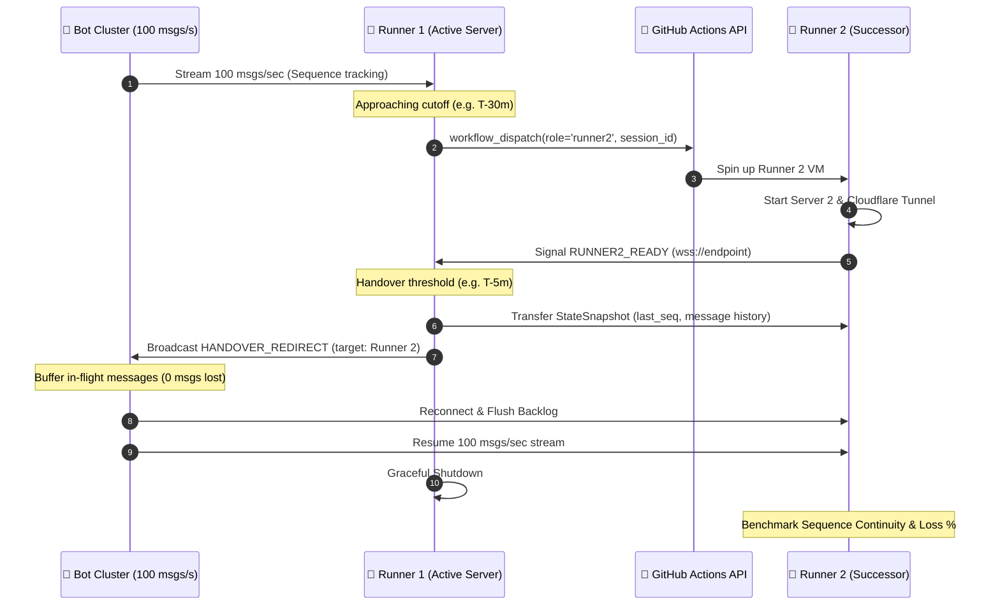

# 🚀 GitHub Actions Runner Benchmarks (`workflow-benchs`)

A comprehensive benchmarking suite comparing GitHub Actions standard hosted runners for **public repositories**, specifically analyzing **x86-64 (`ubuntu-latest`) vs ARM64 (`ubuntu-24.04-arm`)**.

---

## 📌 Free GitHub-Hosted Runner Offerings for Public Repositories

According to the official [GitHub Actions Documentation](https://docs.github.com/en/actions/using-github-hosted-runners/about-github-hosted-runners), GitHub provides **free and unlimited** standard hosted runners for **public repositories**.

Standard runners for public repositories are configured with **4 vCPUs and 16 GB RAM** (twice the resources of standard runners on private repositories, which receive 2 vCPUs and 8 GB RAM):

| OS / Platform | Architecture | CPU | RAM | SSD Storage | Workflow Label | Cost for Public Repos |
| :--- | :--- | :--- | :--- | :--- | :--- | :--- |
| **Linux (Ubuntu 24.04 / 22.04)** | **x86_64** | 4 vCPUs | 16 GB | 14 GB SSD | `ubuntu-latest`, `ubuntu-24.04`, `ubuntu-22.04` | **Free & Unlimited** |
| **Linux (Ubuntu ARM64)** | **ARM64 (aarch64)** | 4 vCPUs | 16 GB | 14 GB SSD | `ubuntu-24.04-arm`, `ubuntu-22.04-arm` | **Free & Unlimited** |
| **Linux (Ubuntu Slim)** | x86_64 | 1 vCPU | 5 GB | 14 GB SSD | `ubuntu-slim` | **Free & Unlimited** |
| **Windows Server** | x86_64 | 4 vCPUs | 16 GB | 14 GB SSD | `windows-latest`, `windows-2025`, `windows-2022` | **Free & Unlimited** |
| **Windows 11 ARM** | ARM64 | 4 vCPUs | 16 GB | 14 GB SSD | `windows-11-arm` | **Free & Unlimited** |
| **macOS (Apple Silicon)** | ARM64 (M-series) | 3 vCPUs | 7 GB | 14 GB SSD | `macos-latest`, `macos-14`, `macos-15` | **Free & Unlimited** |
| **macOS (Intel)** | x86_64 | 4 vCPUs | 14 GB | 14 GB SSD | `macos-15-intel` | **Free & Unlimited** |

---

## 🔬 Benchmark Methodology

The benchmark measures:
1. **CPU Performance**:
   - Single-thread execution speed (Events / sec) via `sysbench cpu` (max-prime: 20,000)
   - Multi-thread execution speed across all vCPUs via `sysbench cpu`
   - Cryptographic hashing throughput (MB/s) with SHA-256
2. **Memory Subsystem**:
   - Sequential Memory Read Bandwidth (MiB/s) via `sysbench memory`
   - Sequential Memory Write Bandwidth (MiB/s) via `sysbench memory`
3. **Storage & Disk I/O Performance (`fio`)**:
   - **4K Random Read IOPS** & Average Latency (`libaio`, `iodepth=64`, `direct=1`)
   - **4K Random Write IOPS** & Average Latency (`libaio`, `iodepth=64`, `direct=1`)
   - **1M Sequential Read Throughput** (MB/s)
   - **1M Sequential Write Throughput** (MB/s)
   - **4K Mixed 70/30 Read/Write IOPS**

---

<!-- BENCHMARK_RESULTS_START -->

# 📊 GitHub Actions Free Runners Benchmark Comparison

Comparison of GitHub Actions standard hosted runners for public repositories (x86-64 vs ARM64).

| Metric | `ubuntu-latest` | `ubuntu-24.04-arm` | `macos-latest` | `macos-15-intel` | `self-hosted` |
| :--- | :---: | :---: | :---: | :---: | :---: |
| **🖥️ System Specs** |  |  |  |  |  |
| Architecture | x86_64 | aarch64 | arm64 | x86_64 | x86_64 |
| OS Version | Ubuntu 24.04.5 LTS | Ubuntu 24.04.5 LTS | macOS 26.6.2 | macOS 15.7.9 | Ubuntu 24.04.5 LTS |
| Kernel | 6.17.0-1022-azure | 6.17.0-1022-azure | 25.6.0 | 24.6.0 | 6.8.0-146-generic |
| CPU Model | AMD EPYC 9V45 96-Core Processor | Neoverse-N2 | Apple M1 (Virtual) | Intel(R) Core(TM) i7-8700B CPU @ 3.20GHz | AMD EPYC Processor |
| vCPUs | 4 | 4 | 3 | 4 | 4 |
| RAM Total (GB) | 15.61 | 15.57 | 7.0 | 14.0 | 7.76 |
| Disk Total (GB) | 144.26 | 144.26 | 319.51 | 324.68 | 55.81 |
| Disk Free (GB) | 85.36 | 107.32 | 96.22 | 108.41 | 11.89 |
| **🧠 CPU Performance** |  |  |  |  |  |
| Sysbench Single-Thread (events/s) | **1993.61** | **1499.22** | **8460121.49** | **3442330.88** | **1358.18** |
| Sysbench Single-Thread Avg Latency (ms) | 0.5 | 0.67 | 0.0 | 0.0 | 0.74 |
| Sysbench Multi-Thread (events/s) | **4122.29** | **5965.64** | **23300374.41** | **10160445.05** | **5345.91** |
| Sysbench Multi-Thread Avg Latency (ms) | 0.97 | 0.67 | 0.0 | 0.0 | 0.75 |
| SHA256 Throughput (MB/s) | **1981.21** | **2050.0** | **2149.58** | **410.21** | **1425.88** |
| **💾 Memory Bandwidth** |  |  |  |  |  |
| Sysbench Mem Read (MiB/s) | **196816.13** | **60422.5** | **62086.53** | **69581.76** | **136063.49** |
| Sysbench Mem Write (MiB/s) | **63152.73** | **105440.35** | **43008.18** | **38478.3** | **34070.3** |
| **🚀 Disk IOPS & Throughput (fio)** |  |  |  |  |  |
| 4K Random Read IOPS | **19948.8** | **18260.8** | **28802.6** | **8458.9** | **504.9** |
| 4K Random Read Latency (ms) | 3.204 | 3.502 | 0.517 | 1.713 | 126.701 |
| 4K Random Read Bandwidth (MB/s) | 77.93 | 71.33 | 112.51 | 33.04 | 1.97 |
| 4K Random Write IOPS | **20029.0** | **19433.1** | **24382.1** | **6555.7** | **504.7** |
| 4K Random Write Latency (ms) | 3.19 | 3.29 | 0.62 | 2.221 | 126.716 |
| 4K Random Write Bandwidth (MB/s) | 78.24 | 75.91 | 95.24 | 25.61 | 1.97 |
| 1M Sequential Read (MB/s) | **398.76** | **341.31** | **9670.37** | **2738.3** | **400.68** |
| 1M Sequential Write (MB/s) | **268.15** | **318.53** | **8470.11** | **2142.29** | **336.35** |
| 4K Mixed 70/30 Total IOPS | **20109.1** | **19532.2** | **49929.1** | **6737.0** | **998.9** |


<!-- BENCHMARK_RESULTS_END -->

---

## 🤖 High-Speed Bot Messaging & Zero-Loss Runner Handoff System

GitHub Actions runners are ephemeral with a maximum execution limit (typically up to 6 hours). For continuous workloads—such as high-frequency messaging brokers, game servers, or bot coordination networks—runners must hand over traffic to a successor runner before shutting down.

This repository implements a high-throughput messaging server and bot cluster with an automated **inter-runner handover protocol**:



### 📊 Handover Benchmark Results (100 Messages/Second)

| Metric | Unbuffered (Abrupt / Hard Cut) | Buffered (Graceful Handover) | Status |
| :--- | :---: | :---: | :---: |
| **Throughput Target** | **100 msgs/sec** | **100 msgs/sec** | Saturated |
| **Concurrent Bot Agents** | **10 bots** | **10 bots** | Continuous |
| **Total Messages Sent** | `852` | `861` | - |
| **Total Messages Received** | `851` | `861` | - |
| **Dropped / Lost Messages** | **`1` dropped** | **`0` dropped** | **✅ 0% LOSS** |
| **Message Loss %** | **`0.12%`** | **`0.00%`** | **Flawless Switch** |
| **Disruption Downtime Window** | `19.44 ms` | `25.73 ms` | Sub-30ms |
| **Average Message Latency** | `0.22 ms` | `0.26 ms` | Sub-millisecond |
| **P95 Message Latency** | `0.29 ms` | `0.27 ms` | Sub-millisecond |

### 🛠️ How to Run

#### 1. Local Benchmark & Comparison
```bash
# Run side-by-side comparison of unbuffered vs buffered failover
python3 scripts/benchmark_handoff.py --mode compare

# Run custom simulation (e.g. 200 msgs/s with 20 bots)
python3 scripts/benchmark_handoff.py --mode simulation --rate 200 --bots 20 --buffer-mode buffered
```

#### 2. Distributed Execution Across GitHub Actions Runners
Trigger via GitHub Actions:
- Workflow: [`.github/workflows/runner-handoff.yml`](file:///home/eouser/whyno/.github/workflows/runner-handoff.yml)
- Supports automated pre-provisioning (`provision_lead_seconds`), scheduled handover (`handover_lead_seconds`), and Cloudflare Quick Tunnels for zero-configuration inter-runner connectivity.

